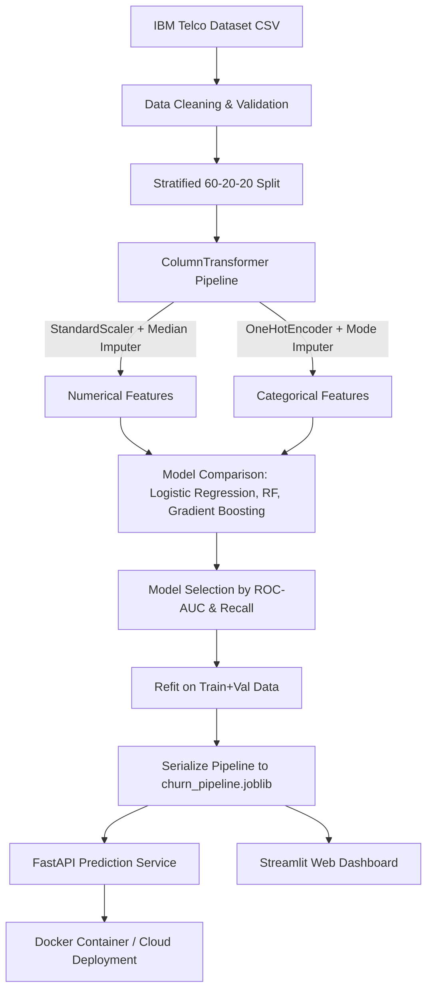

# 📉 Customer Churn Prediction System

[](https://www.python.org/)
[](https://fastapi.tiangolo.com/)
[](https://scikit-learn.org/)
[](https://www.docker.com/)
[]()
[](LICENSE)

An end-to-end, production-oriented Machine Learning system that predicts customer attrition (churn) for telecommunications services. Built with **Scikit-Learn**, served via a high-performance **FastAPI REST API**, containerized using **Docker**, and features an interactive **Streamlit dashboard** for business stakeholders.

---

## 📌 Table of Contents

1. [Executive Summary & Problem Statement](#1-executive-summary--problem-statement)
2. [Dataset Overview](#2-dataset-overview)
3. [System Architecture](#3-system-architecture)
4. [Exploratory Data Analysis (EDA) & Business Insights](#4-exploratory-data-analysis-eda--business-insights)
5. [Feature Engineering & Preprocessing Pipeline](#5-feature-engineering--preprocessing-pipeline)
6. [Machine Learning Models & Benchmark Comparison](#6-machine-learning-models--benchmark-comparison)
7. [Model Selection & Evaluation (Test Set)](#7-model-selection--evaluation-test-set)
8. [Decision Threshold & Business Impact Analysis](#8-decision-threshold--business-impact-analysis)
9. [FastAPI Microservice & Documentation](#9-fastapi-microservice--documentation)
10. [Streamlit Interactive Web Dashboard](#10-streamlit-interactive-web-dashboard)
11. [Docker Containerization](#11-docker-containerization)
12. [Project Directory Layout](#12-project-directory-layout)
13. [Installation & Setup Instructions](#13-installation--setup-instructions)
14. [Automated Testing](#14-automated-testing)
15. [Limitations & Future Roadmap](#15-limitations--future-roadmap)

---

## 1. Executive Summary & Problem Statement

Customer churn occurs when a subscriber terminates their relationship with a service provider. In the telecommunications sector, acquiring new customers costs **5 to 25 times more** than retaining existing ones. 

The primary business goal is to:
- Identify at-risk customers **before** they cancel their contracts.
- Understand the primary churn drivers (contract duration, billing method, fiber optic stability).
- Provide customer success teams with **calibrated probabilities and risk tiers** to trigger targeted retention campaigns.

### The Objective Metric
Because false negatives (failing to detect an actual churner) result in permanent revenue loss, our model selection prioritizes **Recall and ROC-AUC** while controlling precision to avoid unnecessary retention expenditures.

---

## 2. Dataset Overview

We leverage the **IBM Telco Customer Churn Dataset** (`WA_Fn-UseC_-Telco-Customer-Churn.csv`), containing records for **7,043 customers** across 21 features:

- **Customer Demographics:** `gender`, `SeniorCitizen`, `Partner`, `Dependents`
- **Account & Contract Terms:** `tenure` (months), `Contract` (Month-to-month, One year, Two year), `PaperlessBilling`, `PaymentMethod`
- **Subscribed Services:** `PhoneService`, `MultipleLines`, `InternetService` (DSL, Fiber optic, None), `OnlineSecurity`, `OnlineBackup`, `DeviceProtection`, `TechSupport`, `StreamingTV`, `StreamingMovies`
- **Billing Details:** `MonthlyCharges`, `TotalCharges`
- **Target Variable:** `Churn` (`Yes` or `No`)

---

## 3. System Architecture



---

## 4. Exploratory Data Analysis (EDA) & Business Insights

### Data Cleaning Findings
- **Data Type Issue:** The `TotalCharges` column was initially stored as an `object` type because 11 rows had blank string values (`" "`).
- **Root Cause:** All 11 records belonged to brand new customers with `tenure == 0`.
- **Handling Strategy:** Converted to float via `pd.to_numeric(errors="coerce")` and dropped the 11 rows (< 0.16% of dataset), resulting in a clean dataset of **7,032 samples**.
- **Customer ID:** Removed `customerID` as it is a non-predictive database primary key.

### Key Business Insights
1. **Contract Duration:** Month-to-month subscribers experience an attrition rate of **~42.7%**, compared to only **11.3%** for one-year and **2.8%** for two-year contracts.
2. **Tenure Curve:** Churn is heavily front-loaded; subscribers in their first 6 months have the highest attrition risk.
3. **Tech Support & Online Security:** Customers without Tech Support or Online Security churn at twice the rate of customers with active add-ons.
4. **Payment Method:** Customers using **Electronic check** churn significantly more frequently than customers with automatic bank transfer or credit card payments.

---

## 5. Feature Engineering & Preprocessing Pipeline

To eliminate data leakage, all preprocessing parameters (means, standard deviations, categorical vocabularies) are learned **strictly from the training split** using Scikit-Learn's `Pipeline` and `ColumnTransformer`:

```python
from sklearn.compose import ColumnTransformer
from sklearn.pipeline import Pipeline
from sklearn.preprocessing import StandardScaler, OneHotEncoder
from sklearn.impute import SimpleImputer

numeric_transformer = Pipeline(steps=[
    ("imputer", SimpleImputer(strategy="median")),
    ("scaler", StandardScaler())
])

categorical_transformer = Pipeline(steps=[
    ("imputer", SimpleImputer(strategy="most_frequent")),
    ("encoder", OneHotEncoder(handle_unknown="ignore", sparse_output=False))
])

preprocessor = ColumnTransformer(transformers=[
    ("num", numeric_transformer, ["SeniorCitizen", "tenure", "MonthlyCharges", "TotalCharges"]),
    ("cat", categorical_transformer, categorical_features)
])
```

---

## 6. Machine Learning Models & Benchmark Comparison

We evaluated three diverse algorithms across **Accuracy, Precision, Recall, F1 Score, and ROC-AUC** on the 20% validation set:

| Model | Accuracy | Precision | Recall | F1 Score | ROC-AUC |
| :--- | :---: | :---: | :---: | :---: | :---: |
| **Logistic Regression (Balanced)** | 0.7562 | 0.5285 | **0.7674** | **0.6260** | **0.8360** |
| **Gradient Boosting** | **0.8017** | **0.6740** | 0.4920 | 0.5688 | 0.8348 |
| **Random Forest (Balanced)** | 0.7775 | 0.6187 | 0.4251 | 0.5040 | 0.8131 |

### Selection Rationale:
- **Gradient Boosting** maximized raw accuracy (80.2%), but missed **more than 50% of churners** (Recall = 0.4920).
- **Logistic Regression with Balanced Class Weights** achieved the highest **ROC-AUC (0.8360)** and achieved a **Recall of 76.7%**, capturing 3 out of every 4 churners.
- **Decision:** Logistic Regression was selected as the optimal production model for retention prioritization.

---

## 7. Model Selection & Evaluation (Test Set)

After selecting Logistic Regression, the pipeline was refit on the combined **Training + Validation data (5,625 samples)** and evaluated on the untouched **Test set (1,407 samples)**:

| Metric | Test Set Score |
| :--- | :---: |
| **Accuracy** | **72.57%** |
| **Precision (Churn Class)** | **49.01%** |
| **Recall (Churn Class)** | **79.68%** |
| **F1 Score** | **60.69%** |
| **ROC-AUC** | **0.8351** |

### Test Classification Report
```
              precision    recall  f1-score   support

Retained (0)       0.90      0.70      0.79      1033
 Churned (1)       0.49      0.80      0.61       374

    accuracy                           0.73      1407
   macro avg       0.70      0.75      0.70      1407
weighted avg       0.79      0.73      0.74      1407
```

### Generated Visual Artifacts
- **Confusion Matrix:** `reports/confusion_matrix.png`
- **ROC Curve:** `reports/roc_curve.png`
- **Precision-Recall Curve:** `reports/precision_recall_curve.png`

---

## 8. Decision Threshold & Business Impact Analysis

In industry settings, the default 0.5 decision threshold is rarely optimal. Depending on retention intervention costs vs. customer lifetime value, teams can calibrate thresholds:

| Decision Threshold | Accuracy | Precision | Recall | F1-Score | Recommended Business Use Case |
| :---: | :---: | :---: | :---: | :---: | :--- |
| **0.30** | 63.26% | 41.48% | **93.05%** | 0.5738 | Aggressive low-cost automated retention emails (catch 93% of churn) |
| **0.40** | 68.51% | 45.21% | **87.17%** | 0.5954 | Standard retention campaigns |
| **0.50 (Default)**| **72.57%** | **49.01%** | **79.68%** | **0.6069** | Balanced operations |
| **0.60** | 76.33% | 54.14% | 71.66% | 0.6168 | Expensive outreach (1-on-1 account executive calls) |
| **0.70** | 79.39% | 61.11% | 61.76% | 0.6144 | High-cost financial discount incentives |

---

## 9. FastAPI Microservice & Documentation

The production inference service is implemented with **FastAPI** and **Pydantic v2**:

### Endpoints
- `GET /` - Service status and route directory.
- `GET /health` - System health probe and model availability verification.
- `GET /model-info` - Metadata regarding pipeline stages, feature schemas, and performance.
- `POST /predict` - Single customer real-time inference with probability, prediction, and risk tier.
- `POST /predict-batch` - High-throughput batch inference for CRM ingestion.

### Example Request (`POST /predict`)
```json
{
  "gender": "Female",
  "SeniorCitizen": 0,
  "Partner": "Yes",
  "Dependents": "No",
  "tenure": 3,
  "PhoneService": "Yes",
  "MultipleLines": "No",
  "InternetService": "Fiber optic",
  "OnlineSecurity": "No",
  "OnlineBackup": "Yes",
  "DeviceProtection": "No",
  "TechSupport": "No",
  "StreamingTV": "Yes",
  "StreamingMovies": "Yes",
  "Contract": "Month-to-month",
  "PaperlessBilling": "Yes",
  "PaymentMethod": "Electronic check",
  "MonthlyCharges": 85.5,
  "TotalCharges": 256.5
}
```

### Example Response
```json
{
  "churn_prediction": 1,
  "churn_probability": 0.7814,
  "risk_level": "High",
  "message": "Customer is at very high risk of churn. Immediate proactive retention outreach recommended."
}
```

Interactive Swagger documentation is automatically accessible at `http://127.0.0.1:8000/docs`.

---

## 10. Streamlit Interactive Web Dashboard

A complete Streamlit dashboard (`dashboard.py`) enables non-technical business stakeholders to:
- Test hypothetical customer scenarios using sliders and dropdowns.
- Load pre-built high-risk and low-risk customer profiles with 1 click.
- Seamlessly toggle between calling the live FastAPI REST microservice or running local model inference.

Run the dashboard:
```bash
streamlit run dashboard.py
```

---

## 11. Docker Containerization

The microservice is containerized for seamless cloud deployment (AWS ECS, Google Cloud Run, Azure Container Apps):

```bash
# Build the Docker container image
docker build -t customer-churn-api .

# Run container on port 8000
docker run -d -p 8000:8000 --name churn-service customer-churn-api
```
Check health at: `http://localhost:8000/health`.

---

## 12. Project Directory Layout

```text
customer-churn-prediction/
│
├── api/
│   ├── main.py                     # FastAPI REST microservice application
│   └── schemas.py                  # Pydantic v2 validation data models
│
├── data/
│   └── WA_Fn-UseC_-Telco-Customer-Churn.csv # IBM Telco customer dataset
│
├── models/
│   └── churn_pipeline.joblib       # Serialized complete end-to-end pipeline
│
├── notebooks/
│   ├── 01_eda.ipynb                # Exploratory Data Analysis & visual charts
│   └── 02_model_training.ipynb     # Model experimentation & comparison notebook
│
├── reports/
│   ├── confusion_matrix.png        # Evaluation confusion matrix plot
│   ├── roc_curve.png               # ROC curve artifact
│   └── precision_recall_curve.png  # Precision-Recall curve artifact
│
├── src/
│   ├── train.py                    # Production training and pipeline export script
│   └── evaluate.py                 # Evaluation and threshold sensitivity script
│
├── tests/
│   └── test_api.py                 # Pytest test suite for API & schema validation
│
├── .dockerignore
├── .gitignore
├── Dockerfile                      # Production Docker container specification
├── dashboard.py                    # Streamlit interactive UI application
├── requirements.txt                # Pinned dependency requirements
└── README.md                       # Comprehensive project documentation
```

---

## 13. Installation & Setup Instructions

### 1. Clone the Repository
```bash
git clone https://github.com/Gokulraj-max/Customer-Churn-Prediction.git
cd Customer-Churn-Prediction
```

### 2. Create and Activate Virtual Environment
```bash
# Windows PowerShell
python -m venv .venv
.venv\Scripts\Activate.ps1

# Linux / macOS
python -m venv .venv
source .venv/bin/activate
```

### 3. Install Dependencies
```bash
pip install -r requirements.txt
```

### 4. Train the Model Pipeline
```bash
python src/train.py
```

### 5. Launch the FastAPI Prediction Service
```bash
uvicorn api.main:app --reload --host 127.0.0.1 --port 8000
```
Visit `http://127.0.0.1:8000/docs` in your browser.

---

## 14. Automated Testing

The project includes unit, integration, and validation tests with `pytest` and `httpx`:

```bash
pytest -v tests/
```

### Test Coverage Highlights:
- Root `/` and `/health` probe validation.
- Model metadata endpoint validation.
- Real-time prediction payload verification for high-risk and low-risk profiles.
- Validation checks for missing required attributes and negative numerical inputs.
- Batch inference payload verification.

---

## 15. Limitations & Future Roadmap

- **Feature Store & Real-Time Aggregations:** Integrate Feast or Hopsworks for streaming feature updates (e.g., real-time support ticket counts).
- **Drift Detection:** Implement Evidently AI or Prometheus metrics to monitor data drift and model performance degradation over time.
- **Explainability:** Integrate SHAP (SHapley Additive exPlanations) values into the FastAPI response payload to return individualized feature attributions per customer prediction.
- **CI/CD Pipeline:** Add GitHub Actions workflow for automatic linting (`ruff`), testing (`pytest`), and Docker image publishing to GitHub Container Registry.

---

**Developed with ❤️ by Govindh**
